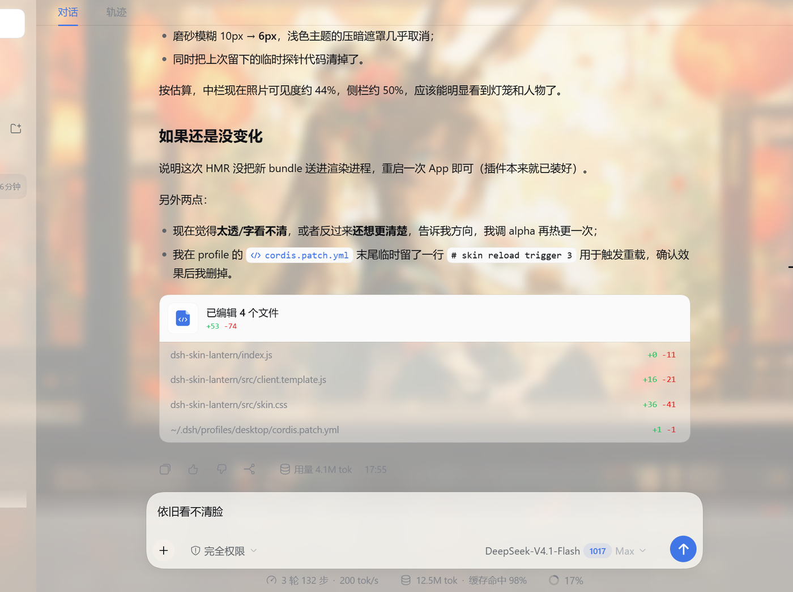
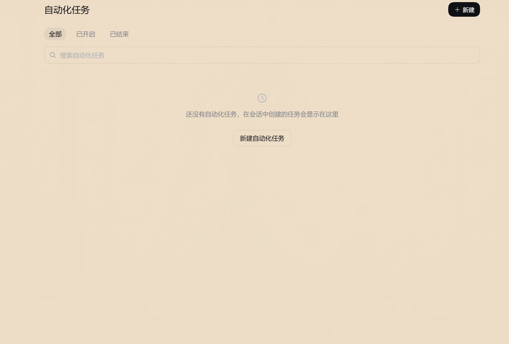
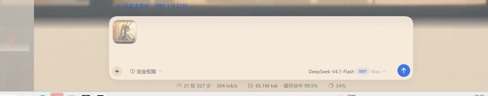

# Lantern Glass · 灯火玻璃

给 **DeepSeek Harness** 换一张照片做背景：窗口是暖纸实底，聊天区透出壁纸，明暗主题各有自己的层次。
纯 CSS 实现，全部逻辑在一个 client bundle 里，没有第三方运行时依赖。

> A wallpaper skin for DeepSeek Harness: warm paper chrome, the artwork shining
> through the conversation, tuned separately for light and dark themes.
> Plain CSS in a single browser bundle — no runtime dependencies.



## 它做了什么

- **照片当背景**：壁纸铺满窗口（`cover`，固定定位，滚动时不动）；
- **聊天区透、页面实**：对话区用一层很薄的白纱透出照片，插件页 / 设置 / 弹窗 / 菜单则是不透明的暖纸色 `rgb(238, 222, 200)`，字永远压在实底上；
- **明暗双主题**：浅色是暖纸，深色是深胡桃木色，对话区各留一点透光；
- **只改宿主的公开 token**：`--dsw-alias-*` / `--dsw-specific-*`，不注入 DOM、不替换根节点，卸载即还原；
- **细节跟着调过**：正文 16px / 500 字重、标题按比例放大、消息操作行和底部统计加深、左侧栏与顶部黑字。

| 页面 / 弹窗：实底 | 消息操作行：加深 |
| --- | --- |
|  |  |

## 安装

```bash
# 1) 把仓库放到本机任意目录，然后用 link: 装进 profile
dsh plugin --profile desktop add "link:C:\path\to\dsh-skin-lantern"

# 2) 重启一次 Harness（bundle 层在启动时组装）
```

重启后在 **设置 → 插件** 里能看到「灯火玻璃 / Lantern Glass」。
卸载：`dsh plugin --profile desktop remove dsh-skin-lantern`。

## 换成你自己的壁纸

仓库**不附带任何图片**——默认构建是一层灯笼色渐变，保证开箱能跑。想用照片：

```bash
# 任意 jpg / png / webp，建议宽度 1600–2000、压到 200 KB 以内
node build.mjs "D:\Pictures\my-photo.jpg"

# 重新加载窗口（或重启 Harness）即可看到
```

`build.mjs` 会把图片转成 data URI 内联进 `client.js`——因为 Harness 的 `/plugins` 路由只下发 bundle 文件，
不会为插件提供相邻静态资源，所以壁纸必须跟着 CSS 走。

## 想自己调

外观全在 [`src/skin.css`](src/skin.css)，改完 `node build.mjs <图片>` 重新构建。
几个主要旋钮：

| 变量 | 作用 | 默认（浅色 / 深色） |
| --- | --- | --- |
| `--dsw-alias-bg-base` | 页面、弹窗、卡片底色 | `rgba(238,222,200,.92)` / `rgba(14,10,8,.9)` |
| `--dsw-specific-sidebar-fill` | 左侧栏（透出壁纸） | `rgba(255,245,234,.44)` / `rgba(12,8,6,.56)` |
| 对话区白纱 | 聊天区透光度 | `rgba(255,250,243,.26)` / `rgba(24,19,17,.5)` |
| `--dsw-specific-menu` | 菜单 / 弹出层 | `rgba(240,226,205,.98)` |
| `--dsh-content-font-size` | 正文字号（整套阶梯跟着变） | `16px` |

## 兼容性

- 面向 **DSH 0.2.x 的 Web / Desktop（含 DSH NEXT 这类定制桌面版）**；浏览器需要支持 `:has()`（Chromium 105+，Electron 都满足）。
- 选择器以**公开 token** 和**宿主的稳定 data 属性**为主（`[data-conversation-content]`、`[data-shell-overlay]`、`[data-composer-stat]`、`[data-clock]` 等）；
  少数位置用 CSS module 类名的子串（如 `_centerCol`、`_actions`），宿主大改版时可能需要跟着调一行。
- 只影响样式：不写文件、不发请求、不碰会话数据。卸载后界面完全回到默认。

## 许可

代码 MIT（见 [LICENSE](LICENSE)）。

仓库**不包含任何第三方插画**：`docs/` 里的截图来自作者本机、用的是作者自备图片，仅作效果展示；
你要发布自己的版本时，请换成你有权使用的图片。默认构建的渐变可以随意使用。
